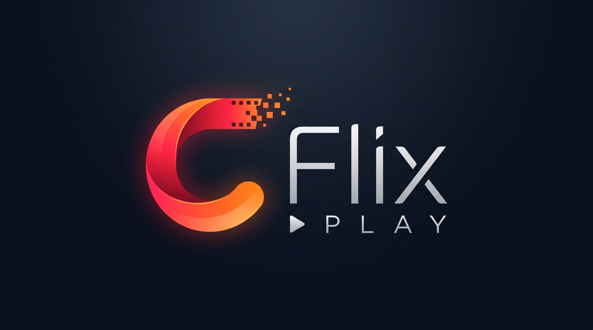

# 🎬 CFlix



**CFlix**, Python ve SQLite ile geliştirilmiş, mobil uyumlu bir **film ve dizi kütüphanesi web uygulamasıdır**. Kullanıcı hesapları, favoriler, izleme geçmişi, kişiselleştirilmiş öneriler, video oynatıcı ve yönetici paneli gibi özellikler sunar.

> **Proje durumu:** CFlix şu anda **yerel ortamda (localhost)** çalışmaktadır. Herkese açık çalışan bir demo veya canlı sunucu bulunmamaktadır. GitHub deposu, kaynak kodlarını ve proje dokümantasyonunu sergilemek içindir.

## 📸 Ekran Görüntüleri

Aşağıdaki görseller CFlix'in kullanıcı arayüzünü ve temel işlevlerini göstermektedir.

### Ana ekran


### Film ve dizi detayları


### İçerik izleme ve video oynatıcı


### Yönetici paneli

.png>)

<details>
<summary><strong>📷 Diğer 7 ekran görüntüsünü göster</strong></summary>

### Yönetici paneli — ek görünüm

 2.png>)

### Giriş ekranı


### Hesap oluşturma


### Kullanıcı profili


### İzleme geçmişi


### Şifre değiştirme


### Görüş ve öneriler


</details>

## ✨ Özellikler

### Kullanıcı yönetimi

- Kullanıcı kaydı, giriş/çıkış ve şifre değiştirme
- Kullanıcı ve yönetici rollerine dayalı yetkilendirme
- Hesaba özel favoriler, profil ve izleme bilgileri

### Film ve dizi kütüphanesi

- Film ve dizi ayrımı, arama ve tür filtreleri
- Favori listesi ve izleme geçmişi
- Kaldığı yerden devam etme
- İzleme davranışı ve tür ilgisine dayalı içerik önerileri

### Video oynatıcı

- MP4 oynatma ve HTTP Range ile ileri/geri sarma
- Mobil uyumlu ve tam ekran oynatma
- Yönetici tarafından ayrı yüklenmiş kalite sürümleri
- Giriş gerektiren video erişimi

### Yönetici paneli

- Film ve dizi içeriklerini ekleme ve yönetme
- MP4 video ve JPG/PNG/WebP kapak yükleme
- Birden fazla video kalitesi ekleme
- Yönetici yetkisi kontrolü

### Görüş ve geri bildirim sistemi

- SQLite üzerinde kalıcı görüş/öneri kuyruğu
- İsteğe bağlı Gmail SMTP bağlantısı
- Başarısız gönderimler için yeniden deneme ve durum takibi

## 🛠️ Kullanılan Teknolojiler

| Alan | Teknoloji |
| --- | --- |
| Backend ve HTTP API | Python 3.10+ (standart kütüphane) |
| Veritabanı | SQLite |
| Frontend | HTML5, CSS3, JavaScript |
| İstemci kodu | JavaScript ES Modules |
| E-posta entegrasyonu | SMTP / Gmail |
| Testler | Python `unittest`, Node.js test çalıştırıcısı |
| Hazırlanmış dağıtım altyapısı | Docker, Docker Compose, Caddy |
| Sürüm kontrolü | Git, GitHub |

Temel uygulamayı çalıştırmak için **pip veya Node.js paketi kurmak gerekmez**. Node.js yalnızca JavaScript testlerini çalıştırmak için kullanılır. Docker imajında Python 3.13 kullanılır.

## 📁 Proje Yapısı

```text
CFlix/
├── docs/
│   └── screenshots/          # README'de kullanılan ekran görüntüleri
├── public/                   # Arayüz, stiller, JavaScript ve oynatıcı
├── tests/                    # Python ve JavaScript testleri
├── server.py                 # HTTP API, kimlik doğrulama, SQLite ve medya
├── create_admin.py           # Yönetici hesabı oluşturma
├── setup_gmail.py            # Komut satırından Gmail kurulumu
├── setup_gmail_window.py     # Yerel tarayıcı üzerinden Gmail kurulumu
├── retry_feedback.py        # Geri bildirim kuyruğunu yeniden deneme
├── baslat.bat                # Windows başlatma aracı
├── gmail_kurulum.bat         # Windows Gmail kurulum aracı
├── Dockerfile                # Docker imajı
├── compose.yaml              # Docker Compose yapılandırması
├── Caddyfile                 # Caddy / HTTPS yapılandırması
├── .env.example              # Örnek ortam değişkenleri
├── .gitignore                # Paylaşılmayacak dosya ve klasörler
├── DEPLOY.md                 # Dağıtım ve yedekleme notları
├── RELEASE_REPORT.md         # Test ve sürüm değerlendirmesi
└── README.md                 # Proje tanıtımı
```

> **Veri gizliliği:** `data/` klasörü (SQLite veritabanı ve yüklenen medya) ile gerçek `.env` dosyası Git deposuna dahil edilmez. Mevcut `fatihflix.db` dosya adı, önceki verilerle uyumluluk için korunmuştur.

## 💻 Yerel Kurulum

### Gereksinimler

- Python **3.10 veya üzeri**
- Git (depoyu klonlamak için)
- Güncel bir web tarayıcısı

### 1. Depoyu indirin

```bash
git clone https://github.com/Fatiossa5/CFlix.git
cd CFlix
```

### 2. Python sürümünü kontrol edin

```bash
python --version
```

### 3. İsteğe bağlı ortam dosyasını oluşturun

Windows PowerShell:

```powershell
Copy-Item .env.example .env
```

`.env` içindeki değerleri yerel ihtiyacınıza göre düzenleyin. Yerel HTTP kullanımı için `COOKIE_SECURE=0` ayarı uygundur. Gerçek SMTP şifrelerini veya `.env` dosyasını Git'e eklemeyin.

### 4. Uygulamayı çalıştırın

```bash
python server.py
```

Windows'ta alternatif olarak `baslat.bat` çalıştırılabilir. Tarayıcıda şu adresi açın:

**http://localhost:3000**

Varsayılan dinleme adresi `0.0.0.0:3000` olduğundan uygulamaya aynı ağdaki cihazlardan bilgisayarın yerel IP adresiyle erişilebilir. Sadece aynı bilgisayardan erişim isteniyorsa `.env` içine `HOST=127.0.0.1` yazın. Telefonda `localhost`, bilgisayarı değil telefonun kendisini ifade eder.

### 5. Yönetici hesabı oluşturun

```bash
python create_admin.py --email admin@cflix.local --name Admin
```

Komut yeni hesap için rastgele bir parola oluşturur; parola terminalde **bir kez** gösterilir. Güvenli biçimde saklayın ve daha sonra değiştirin. Aynı e-posta adresine sahip hesap varsa mevcut hesabın parolası veya rolü değiştirilmez. İlk kullanıcı kaydı otomatik olarak yönetici yetkisi almaz.

## ✉️ Gmail SMTP ve Geri Bildirimler

Geri bildirimlerin e-posta yoluyla gönderilmesi **isteğe bağlıdır**. Gmail ayarları için `gmail_kurulum.bat` veya `setup_gmail.py` kullanılabilir. İlgili ortam değişkenleri:

```dotenv
SMTP_USERNAME=
SMTP_PASSWORD=
SMTP_FROM=
FEEDBACK_RECIPIENT=
```

Gmail için normal hesap şifresi yerine **Google Uygulama Şifresi** kullanılmalıdır. SMTP ayarlanmadığında veya gönderim başarısız olduğunda mesajlar SQLite kuyruğunda saklanır.

Kuyruğu elle yeniden denemek için:

```bash
python retry_feedback.py --limit 25
```

> **Dikkat:** SMTP ayarlanmışsa bu komut gerçek e-posta gönderebilir. SMTP sunucusunun mesajı kabul etmesi, alıcının gelen kutusuna kesin teslim edildiği anlamına gelmez.

## 🧪 Testler

Python testleri:

```bash
python -m unittest discover -s tests -v
```

JavaScript oynatıcı testleri:

```bash
node --test tests/test_player.mjs tests/test_player_controls.mjs
```

Öneri sistemi testleri:

```bash
node --test tests/test_recommendations.mjs
```

Python testleri geçici SQLite veritabanları ve ayrı HTTP sunucuları kullanır; SMTP işlemleri taklit edilir. Sentetik medya testleri gerçek cihaz ve codec uyumluluğu testlerinin yerini tutmaz. Mevcut doğrulama notları için [RELEASE_REPORT.md](RELEASE_REPORT.md) dosyasına bakın.

## 🔐 Güvenlik Yaklaşımı

Projede aşağıdaki önlemler uygulanmıştır:

- Rastgele tuz ile **600.000 turlu PBKDF2-SHA256** parola özeti
- `HttpOnly`, `SameSite=Strict` ve HTTPS için `Secure` oturum çerezleri
- Parametreli SQL sorguları ve rol/yetki kontrolleri
- Kaynak/JSON istekleri için CSRF kontrolleri
- Dosya imzası, boyutu ve yol doğrulamaları
- Content Security Policy (CSP) ve ek HTTP güvenlik başlıkları
- Giriş kontrollü video erişimi
- Bağlantı sayısı ve soket zaman aşımı sınırları

Bu önlemler tam güvenlik veya yüksek trafik dayanıklılığı garantisi vermez. Özellikle internete açık dağıtım öncesinde ayrı güvenlik ve yük testleri gerekir.

## 🐳 Docker ve Dağıtım Notları

Projede Docker Compose ile kalıcı depolama ve Caddy üzerinden HTTPS kullanımına yönelik yapılandırma dosyaları bulunur. Ayrıntılı hazırlık ve yedekleme notları [DEPLOY.md](DEPLOY.md) dosyasındadır.

**Bu depo canlı bir CFlix hizmeti değildir.** Herkese açık URL, alan adı veya çalışan bir sunucu sağlanmamaktadır. GitHub'da yayınlanan içerik kaynak kodu ve dokümantasyondur.

## ⚠️ Bilinen Sınırlar

- Tek süreç / tek uygulama örneği hedeflenir; çoklu instance desteği yoktur.
- Oturumlar ve bazı deneme sayaçları bellekte tutulur; sunucu yeniden başlatıldığında sıfırlanır.
- Kullanıcılar, katalog, favoriler, geçmiş, medya ve geri bildirim kuyruğu SQLite/yerel depolamada kalıcıdır.
- E-posta doğrulama, otomatik şifre sıfırlama ve çok faktörlü kimlik doğrulama bulunmaz.
- CDN, otomatik video dönüştürme ve yüksek trafik için ölçekleme bulunmaz.
- MP4 yükleme sınırı **2 GiB**, kapak yükleme sınırı **10 MiB**'dir.
- Video kalite sürümleri otomatik oluşturulmaz; yönetici tarafından ayrı yüklenir.
- Dizilerin bölümleri ayrı içerik kayıtları olarak eklenebilir.
- Yayınlanmayan yüklemeler için otomatik temizleme bulunmaz.
- Örnek katalog kurgusaldır. Tanıtım videosu Google'ın Big Buck Bunny örneğinden; bazı görseller Unsplash, yazı tipleri Google Fonts kaynaklarından gelebilir. Harici servis erişimi ve medya kullanım hakları ayrıca değerlendirilmelidir.

Yalnızca kullanım veya paylaşım hakkına sahip olduğunuz içerikleri yükleyin.

## 📌 Proje Durumu

**CFlix, yerel ortamda çalışan bir portföy projesidir.** Kod ve dokümantasyon GitHub üzerinden incelenebilir; kişisel kullanıcı verileri, gerçek SMTP ayarları ve yüklenen medya dosyaları paylaşılmaz.

## 👨‍💻 Geliştirici

**Muhammed Fatih Atmaca**  
GitHub: [@Fatiossa5](https://github.com/Fatiossa5)

---

*CFlix — Film ve dizi kütüphanesi web uygulaması.*
